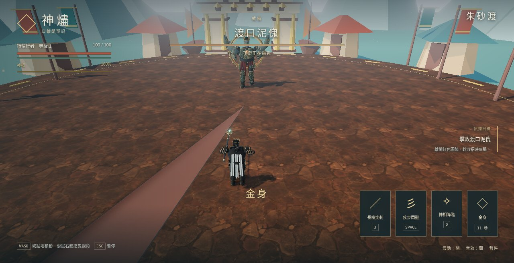

# 神燼：日輪朝聖記

從朱砂渡的銅鈴，到日輪神殿的聖火，一名持槍行者走過三場試煉。這是以古印度神話奇幻為靈感的單人 3D 瀏覽器遊戲。設計參考《天傳 Online》（TANTRA Online，在中國大陸稱《密傳》）的信仰選擇及成長歷程。地名、神誓、故事和遊戲資產沿用或製作於《神燼》。[名稱資料](https://acg.gamer.com.tw/acgDetail.php?s=7341) · [當年遊戲介紹](https://gnn.gamer.com.tw/detail.php?sn=17563)



## 開始行旅

需要 Node.js 22.12 以上及支援 WebGL 2 的瀏覽器。

```bash
npm ci
npm run dev
```

開啟 http://127.0.0.1:4173 ，在行旅頁選擇信仰，再前往朱砂渡。生蓮能回血、持輪能短暫護身、焚日能重新充滿神相。每次首次通過一站都會提升生命與槍術，可返回已開放的地點重打或換信仰。瀏覽器會記住信仰與已通過的地點，戰鬥中途離開則從該站開頭重新挑戰。

| 操作 | 按鍵 |
| --- | --- |
| 移動 | 點地面、WASD 或方向鍵 |
| 出槍 | J、點近身敵人或按技能列 |
| 閃避 | 空白鍵 |
| 神相降臨 | Q |
| 使用信仰神技 | E |
| 轉動視角 | 按住滑鼠右鍵拖曳 |
| 暫停或返回行旅 | Esc 開啟選單 |

## 開發與素材

`npm test` 執行規則與動畫測試，`npm run build` 建立 dist，`npm run validate:assets` 驗證模型。瀏覽器版在 preview，村落與塔群由 Three.js 建立，內殿與人物載自原創 Blender 模型。行旅頁背景來自本專案的美術概念圖。

[Blender 重建說明](tools/blender/README.md) · [UE5 早期獨立戰鬥原型](unreal/README.md) · [舊版 v0.2 紀錄](docs/STATUS.md) · [素材與第三方聲明](THIRD_PARTY_NOTICES.md)

原創程式採用 [MIT](LICENSE)。本版行旅、存檔、信仰與三站關卡實作於瀏覽器端。
