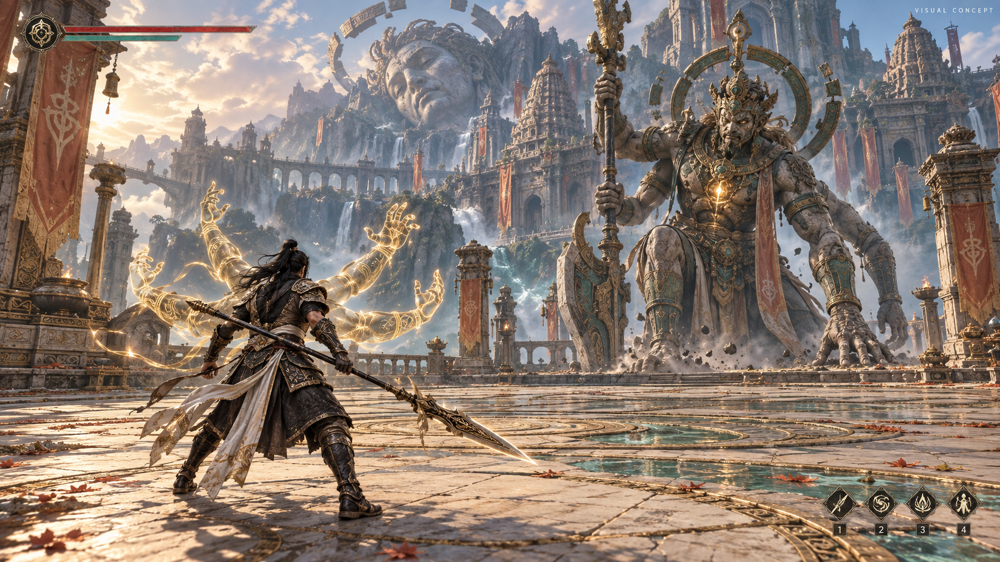
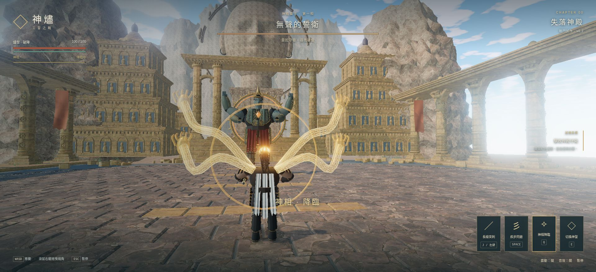

# 神燼：三誓之戰 · Project Shenjin

[](https://github.com/NickYCLin/project-shenjin/actions/workflows/ci.yml)
[](LICENSE)

> 諸神已逝。你的誓言，才正要開始。

## 視覺目標



**這張圖是本專案已確認的美術目標。** 它是 AI 生成的概念圖，目前實機尚未達到這個品質。
開發方向是寫實神話動作 RPG；早期低多邊形原型僅供玩法驗證，不是最終美術風格。

美術迭代以這張圖為基準：密集的神殿雕刻與拱廊、巨大神首與四臂守衛、細緻的青銅盔甲、
磨損石材與布料、金色神相，以及暖陽與青藍遠景的空間層次。每次美術更新都要提供真正的
Blender 渲染或遊戲截圖，依上述項目比較進展，不把概念圖當成已完成的遊戲畫面。

## 目前進度

原創神話動作 RPG 的開源起點。這個版本聚焦「失落神殿」的一場守衛戰，
提供可重建的 **Blender 3D 資產**、**Unreal Engine 5 C++ 專案**，
以及方便試玩操作的 **瀏覽器戰鬥研究原型**。

**目前是早期原型，並非完成的 3A 遊戲、20–30 分鐘展示版或 MMORPG。**
v0.2 已加入有骨架的原創角色、13 段動作、分層盔甲、雕刻神殿與 2K PBR 貼圖。
仍缺少精雕角色、自然布料／頭髮動態、完整環境美術與配音，距離上方目標還有明顯差距。
UE5 是主要開發方向；瀏覽器試作是獨立的手感實驗，不代表 UE5 畫面、效能或程式驗證。



*上圖是 v0.2 瀏覽器原型實際截圖。另可查看 [Blender 場景渲染](art/renders/temple-v2.png)
與[角色渲染](art/renders/animation-preview.png)，均為 repository 中模型的實際輸出。*

## 立即試玩瀏覽器原型

需要 Node.js 22.12+ 與支援 WebGL 2 的桌面瀏覽器。Clone 已包含場景與動畫 GLB，無需先安裝 Blender。

```bash
gh repo clone NickYCLin/project-shenjin
cd project-shenjin
npm ci
npm run dev
```

開啟終端顯示的 `http://127.0.0.1:4173/`，點選「踏入失落神殿」。

| 操作 | 按鍵 |
| --- | --- |
| 移動 | WASD / 方向鍵 |
| 長槍突刺 | J / 滑鼠左鍵 |
| 閃避（消耗體力，短暫無敵） | Space |
| 神相降臨（滿能量，持續 6 秒） | Q |
| 切換燼誓／潮誓 | E |
| 調整視角 | 滑鼠右鍵拖曳 |
| 暫停／繼續 | Escape |

燼誓偏向傷害，潮誓以較低傷害換取命中回復。守衛重擊前會標示紅色地面圓陣；
閃出範圍或抓準無敵時間，再趁收招反擊（額外 25% 傷害）。長槍在出招 0.20 秒命中，
閃避可取消突刺；守衛在下砸動作末端命中。生命低於一半後，守衛進入更快的第二相。
勝利與敗北都可重新挑戰。切換分頁會自動暫停。

此試作僅支援單人鍵鼠遊玩，沒有存檔、帳號、多人、商城或遙測。
音效可自行開啟，使用瀏覽器即時合成。啟動後遊戲不依賴外部 API。
可關閉鏡頭震動；偵測到系統偏好減少動態時預設關閉。

## Blender 與 Unreal Engine

- [Blender 重建說明](tools/blender/README.md)：Python 生成腳本、`.blend`、GLB、FBX、尺度與預覽渲染。
- [UE5 專案說明](unreal/README.md)：安裝引擎、編譯、匯入原創 FBX、建立地圖和 Play。
- [目前驗證與限制](docs/STATUS.md)：可驗證成果和下一個里程碑。

UE5 引擎必須另外取得。本次製作環境未安裝 UE5，**原生專案尚未編譯、開啟或打包驗證**。
C++ 程式審閱與 Python 語法檢查不等同引擎實測。GitHub CI 目前僅驗證 browser 邏輯、資產格式與建置。

## 開發檢查

```bash
npm test                 # 戰鬥規則、動畫、鏡頭與完整勝敗模擬
npm run validate:assets  # Khronos glTF Validator + 網格預算
npm run build            # 可攜的瀏覽器 build → dist/
```

```text
art/source/       可編輯 Blender 場景
art/exports/      原創 GLB / FBX 與資產資料
art/reference/    已確認的視覺目標
art/textures/     CC0 材質來源、原圖與校驗清單
tools/blender/    可重建的資產生成程式
unreal/           UE5 C++ 專案與匯入流程
preview/          獨立瀏覽器戰鬥研究原型
docs/             設計、里程碑與驗證紀錄
```

## 開源與貢獻

原創程式、文件、程序化模型與渲染採 [MIT](LICENSE)。Poly Haven 材質原圖採 CC0。
外部相依套件與工具保留各自授權；
UE 引擎不包含在本 repository，詳見 [素材與第三方聲明](THIRD_PARTY_NOTICES.md)。

請以小範圍 PR 提出變更，附測試方式與畫面變更的實際截圖。新素材請提供來源與可散布授權。
優先改善角色與場景寫實程度、動作自然度，以及在已安裝 UE5 的機器上完成原生驗證。
